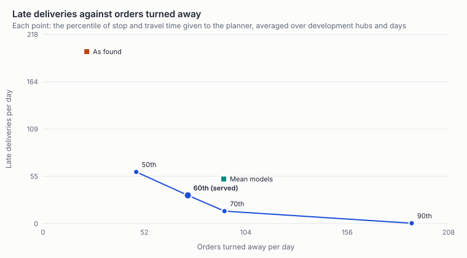
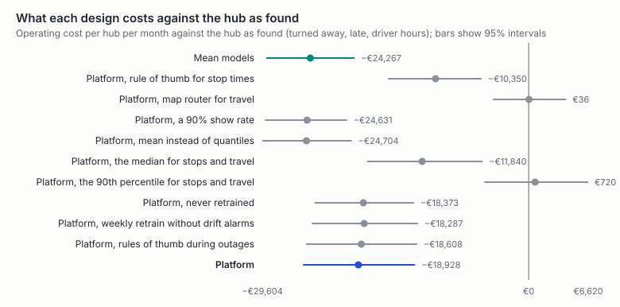
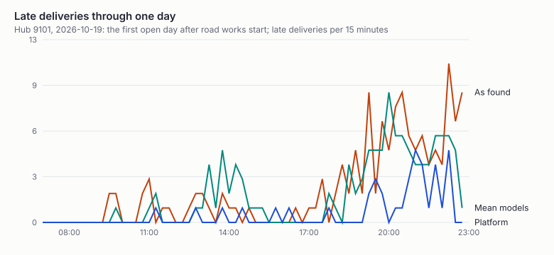
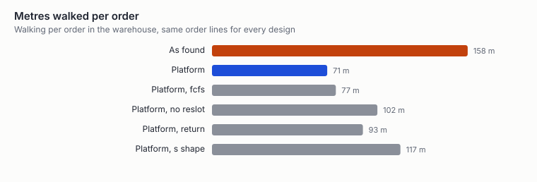
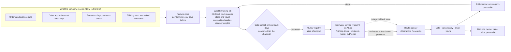
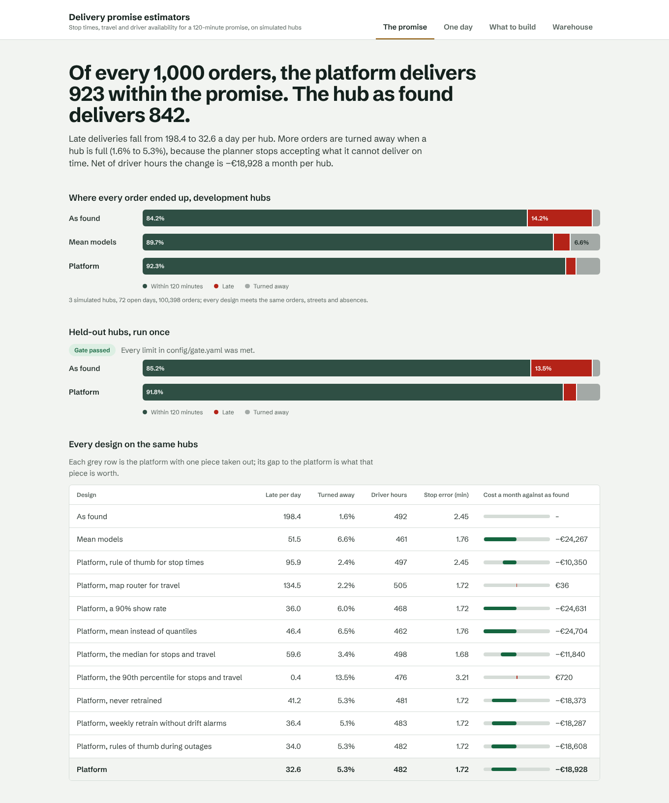
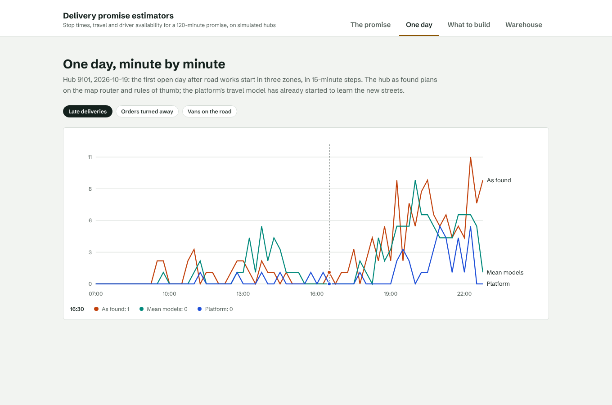
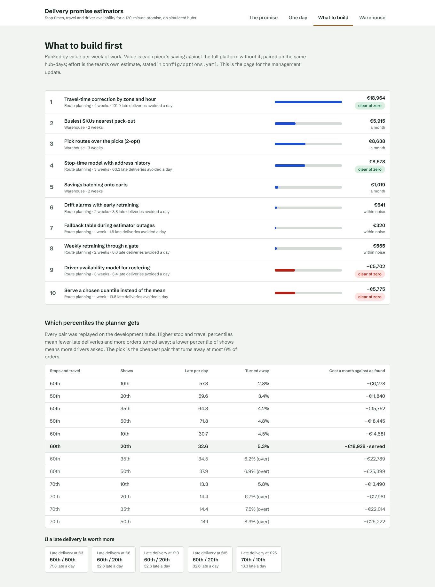

# delivery-promise-estimators

Estimators for a route planner that promises groceries in 120 minutes:

- how long each stop takes at the door;
- how much slower the streets are than the map router thinks;
- which rostered drivers will actually turn up.

Each is judged by what the planner does with it: orders delivered late, orders turned away, driver hours and shifts
short of plan.

Around the models sits what keeps them running:

- **Retraining.** A weekly retrain through a release gate, early retraining when coverage drifts, MLflow tracking
  and a registry.
- **Serving.** A FastAPI service with a fallback that always answers, deployed on AKS with Terraform.
- **For the business.** A roster explanation a hub lead can read, and a generated decision memo for management.

A first piece of **warehouse optimization** (routes over the picks, savings batching, slotting) is measured the same
way. Everything is measured on simulated hubs, against the hub as it is often run.

**Why.**

- **Error is not the target.** A stop-time model can win on mean absolute error and still make the planner accept
  orders it cannot deliver. Under-estimates make orders late; over-estimates turn customers away and leave drivers
  idle. The cost of each differs, so the planner should get a chosen percentile, not the mean.
- **Streets change overnight.** Road works start, it rains. A model trained last month keeps planning on last
  month's streets unless something watches it.
- **The planner always needs an answer.** An estimator that is down must not stop a hub from taking orders.

<!-- results:start -->

### Dashboard (development hubs)

| Development | Platform | Mean models | As found |
|---|---:|---:|---:|
| Late deliveries per day (95% interval) | **32.6 (26.1–39.9)** | 51.5 (42.3–61.5) | 198.4 (172.0–226.1) |
| Accepted orders delivered late | **2.5%** | 4.0% | 14.5% |
| Orders turned away | **5.3%** | 6.6% | 1.6% |
| Orders delivered within the promise | **92.3%** | 89.7% | 84.2% |
| Driver hours per day | **482** | 461 | 492 |
| Shifts two or more drivers short of plan, per week | **2.7** | 3.8 | 2.7 |
| Operating cost per hub per month against as found | **−€18,928 (−€25,078 to −€12,611)** | −€24,267 (−€29,182 to −€19,344) | – |
| Stop-time error (mean absolute, minutes) | **1.72** | 1.76 | 2.45 |
| Stops under the served estimate | **60%** | 61% | 22% |
| Legs under the served travel estimate | **58%** | 49% | 23% |

3 simulated hubs, 72 open days, 100,398 orders. Money uses `config/value.yaml`; the interval is a paired bootstrap over hub-days.







### Every design on the same hubs

| Design | Late per day | Turned away | Driver hours | Short shifts / week | Stop MAE | Cost vs as found / month |
|---|---:|---:|---:|---:|---:|---:|
| As found: rules of thumb for stops, the map router for travel, a 90% show rate | 198.4 | 1.6% | 492 | 2.7 | 2.45 | €0 |
| Mean models: XGBoost on squared error, trained once | 51.5 | 6.6% | 461 | 3.8 | 1.76 | −€24,267 |
| Platform, rule of thumb for stop times | 95.9 | 2.4% | 497 | 1.9 | 2.45 | −€10,350 |
| Platform, map router for travel | 134.5 | 2.2% | 505 | 1.9 | 1.72 | €36 |
| Platform, a 90% show rate | 36.0 | 6.0% | 468 | 2.7 | 1.72 | −€24,631 |
| Platform, mean instead of quantiles | 46.4 | 6.5% | 462 | 4.1 | 1.76 | −€24,704 |
| Platform, the median for stops and travel | 59.6 | 3.4% | 498 | 2.0 | 1.68 | −€11,840 |
| Platform, the 90th percentile for stops and travel | 0.4 | 13.5% | 476 | 2.7 | 3.21 | €720 |
| Platform, never retrained | 41.2 | 5.3% | 481 | 2.7 | 1.72 | −€18,373 |
| Platform, weekly retrain without drift alarms | 36.4 | 5.1% | 483 | 2.5 | 1.72 | −€18,287 |
| Platform, rules of thumb during outages | 34.0 | 5.3% | 482 | 2.7 | 1.72 | −€18,608 |
| **Platform: quantile models chosen by planner replay, retrained through a gate** | 32.6 | 5.3% | 482 | 2.7 | 1.72 | −€18,928 |

### Retraining, drift and outages

| Design | Late per day after road works | Late on outage days | Retrains (promoted) | Drift retrains |
|---|---:|---:|---:|---:|
| Platform, never retrained | 48.7 | 48.3 | 0 (0) | 0 |
| Platform, weekly retrain without drift alarms | 41.3 | 38.7 | 9 (8) | 0 |
| Platform, rules of thumb during outages | 34.7 | 49.2 | 24 (22) | 15 |
| Platform: quantile models chosen by planner replay, retrained through a gate | 34.2 | 31.7 | 24 (22) | 15 |

### Warehouse picking

| Picking design | Metres per order | Picker minutes per order | Orders per cart | Picker hours per day |
|---|---:|---:|---:|---:|
| As found: first come first served, S-shape, slots as they are | 158 | 3.24 | 4.3 | 75 |
| **Platform: savings batching, 2-opt routes over the picks, busiest SKUs near pack-out** | 71 | 1.93 | 4.4 | 44 |
| Platform, first come first served | 77 | 2.01 | 4.3 | 46 |
| Platform, slots as they are | 102 | 2.40 | 4.4 | 55 |
| Platform, return routes | 93 | 2.26 | 4.4 | 52 |
| Platform, S-shape routes | 117 | 2.61 | 4.4 | 60 |



### Held-out hubs (run once)

| Held-out | Platform | Mean models | As found |
|---|---:|---:|---:|
| Late deliveries per day (95% interval) | **40.0 (29.4–52.5)** | 58.5 (44.2–74.0) | 188.1 (159.4–217.7) |
| Accepted orders delivered late | **3.0%** | 4.5% | 13.7% |
| Orders turned away | **5.3%** | 6.1% | 1.4% |
| Orders delivered within the promise | **91.8%** | 89.7% | 85.2% |
| Driver hours per day | **491** | 472 | 498 |
| Shifts two or more drivers short of plan, per week | **1.8** | 2.7 | 2.2 |
| Operating cost per hub per month against as found | **−€13,605 (−€18,483 to −€8,747)** | −€19,106 (−€23,647 to −€14,744) | – |
| Stop-time error (mean absolute, minutes) | **1.65** | 1.68 | 2.26 |
| Stops under the served estimate | **59%** | 60% | 27% |
| Legs under the served travel estimate | **56%** | 45% | 21% |

3 simulated hubs, 72 open days, 100,430 orders. Money uses `config/value.yaml`; the interval is a paired bootstrap over hub-days.

Gate (`config/gate.yaml`) on the held-out hubs: **passed**.

The record of that run: [docs/heldout.md](docs/heldout.md).

The decision memo for management, generated from these numbers: [reports/decision_memo.md](reports/decision_memo.md).

<!-- results:end -->

**Reading the results.**

- **Late deliveries fall by four fifths, with more orders turned away.** On the held-out hubs, late deliveries fall
  from 188 to 40 a day per hub. The planner, given honest estimates, stops accepting orders it cannot deliver in
  120 minutes, so 5.3% of orders are turned away instead of 1.4%. Orders delivered within the promise rise from
  85% to 92%.
- **Travel matters most.** Without the travel model the platform costs as much as the hub as found. Road works
  and rush hours by zone are what the map router misses. The live congestion index, fitted each morning from the
  last three days of legs, is what lets the model catch new road works within a day.
- **Better error does not mean better operations.** The median model has the lowest stop-time error and half again
  as many late deliveries as the served 60th percentile (62 against 40 a day on the held-out hubs, at about the
  same cost). The 90th percentile is almost never late, but it turns
  away 13% of orders and costs more than the hub as found.
- **The cheapest design is over the service level.** Mean models, and the platform without its availability
  model, cost less money: they ask fewer drivers and turn more customers away (6.1% and 6.5%), over the 6% the
  business allows. The memo shows this rather than ranking them first. If a turned-away order were worth more
  than its €9.50 margin, the gap would close.
- **The safeguards earn their keep in bad weeks, not on average.** After the road works start, retraining and drift
  alarms keep late deliveries lower: 43 a day against 55 without retraining on the held-out hubs. Over the whole
  month their money value is within noise, and so is the fallback table's: the two outages were short.
- **Warehouse: slotting and routing carry the gain.** A tour over the pick locations and the busiest SKUs near
  pack-out roughly halve the walking. Savings batching adds little on carts this small.

## How it works



| Piece | What it does | Where |
|---|---|---|
| **Stop time** | Minutes at the door from crates, empties, floor and lift, building, zone, hour, forecast, and the address's own history (how slow it has been against a plain norm). One XGBoost model learns the 50th–90th percentiles at once. | `dpe/estimators/models.py`, `dpe/features/store.py` |
| **Travel** | The slowdown over the map router by zone pair, hour, weekday and rain. It is learned relative to a live congestion index fitted each morning from the last days' telematics, so new road works show up the next day. Served as a zone × zone × hour matrix. | [ADR 0003](docs/adr/0003-travel-as-a-correction-matrix.md) |
| **Availability** | Each rostered driver's chance of coming, from tenure, their own recent absences and absences across the hub (a flu wave shows there first). These are summed into a distribution of shows; drivers are asked until a chosen percentile of shows covers the plan. | [ADR 0004](docs/adr/0004-availability-per-driver.md) |
| **Choosing the percentile** | The planner is replayed with every pair of percentiles. The pick is the cheapest pair that turns away no more orders than the business allows. | [ADR 0002](docs/adr/0002-serve-a-quantile.md), `reports/sweep.json` |
| **Retraining** | Weekly through a gate: pinball loss on held-back days, no worse than the champion. After two days of low coverage, daily for five days. Rows weigh more the more recent they are. | [ADR 0005](docs/adr/0005-retraining-gate-and-drift.md) |
| **MLflow** | The training job reads the lake, logs parameters, row counts and the gate's verdict, registers every version, and moves the `champion` alias only on a pass. The service's init container fetches `@champion`. | `dpe/ops/train_job.py`, `dpe/ops/fetch_model.py` |
| **Always an answer** | A failing or missing model answers from a last-known-good table, or the rule of thumb, and says which. Two or more replicas, a disruption budget and readiness probes. | [ADR 0006](docs/adr/0006-always-answer.md) |
| **Roster explanation** | `/v1/roster` says why it asks for N drivers, from the trees' own contributions. A language model may reword the facts but not add a number. | [ADR 0009](docs/adr/0009-explanations.md) |
| **Picking** | A tour over the pick locations on true walking distances (2-opt), savings batching onto 12-crate carts, and the busiest SKUs moved nearest pack-out. | [ADR 0007](docs/adr/0007-warehouse-picking.md) |
| **Decision memo** | The value of each piece (paired against the platform without it), the team's effort estimate, and which percentile is cheapest for each cost of a late delivery. Generated for the top-management update. | [reports/decision_memo.md](reports/decision_memo.md) |
| **Azure** | AKS with workload identity and a training node pool that scales to zero, ACR, a storage account for the lake and MLflow artifacts, PostgreSQL for MLflow, Key Vault, Log Analytics, and a budget. | `infra/terraform`, `deploy/k8s/base` |

## The simulated hubs, and what is simulated

`dpe/world` builds each hub:

- **Customers and orders.** 6,000 addresses in a 12 × 12 km square, in 16 zones. Orders arrive through the day, more
  on Saturdays and hot days, and none on Sunday.
- **Stops.** True stop minutes depend on crates, stairs without a lift, parking at that address, the customer, rain
  and new drivers, with a long tail when nobody opens.
- **Streets.** Rush hours differ by zone, rain slows everything, and road works start in three zones in the middle
  of the evaluation.
- **Drivers.** A pool of drivers with tenure and their own reliability, and a flu wave or two.
- **Outages.** The estimator service goes down twice, for 90 to 200 minutes.
- **Warehouse.** A 16-aisle warehouse with a skewed assortment.

The planner (`dpe/sim/planner.py`) stands in for the company's. It accepts an order if its estimate says the order
can make 120 minutes. It sends a free driver with the most urgent ready order plus the nearest orders that still
make their promise. Then the tour is driven on the truth. Every design runs on the same hubs, days, orders, streets
and absences, and the platform never imports the world (`tests/test_invariants.py`).

**Limits, stated plainly.**

- **The world is a model.** Hubs, customers, streets and drivers are simulated, and the planner is a plain stand-in
  for the real one. The ranking between designs is the result; the euro amounts depend on `config/value.yaml`.
- **Logs are the same for every design.** The logs a design retrains on are the same for every design: the
  company's records do not depend on which estimator ran that day.
- **Picking is simplified.** There is no aisle congestion and no picker skill, and the pick-time estimate the
  dispatch would need is not built yet.
- **Infrastructure is not deployed.** The Terraform and manifests are validated in CI, not applied to a real
  subscription. The MLflow job runs against a local SQLite store in the tests.

## Run it

```bash
pip install -r requirements-dev.txt
python -m pytest                                   # about half a minute
python -m dpe.eval.cli quick                       # one hub, eight days, three designs
python -m dpe.eval.cli evaluate                    # every design on the development hubs -> reports/, charts, this README
python -m dpe.eval.cli gate                        # the platform against config/gate.yaml (held-out; --dev for development)
python -m dpe.sim.export --seed 9101 --through 40 --out data/lake
MLFLOW_TRACKING_URI=sqlite:///mlflow.db python -m dpe.ops.train_job --lake data/lake --through 40 --out models/current
DPE_MODEL_DIR=models/current uvicorn dpe.service.api:app --port 8080    # estimates and the dashboard (after pnpm build in web/)
```

## Dashboard







React, Vite, Tailwind and Framer Motion. It is organised in feature folders (`promise`, `day`, `decisions`,
`warehouse`), with theme tokens in `web/src/theme`. Every screen has loading, error-with-retry and empty states. It
is tested end to end with Playwright and axe.

## Repository

| Path | What it holds |
|---|---|
| `dpe/world` | The simulated hubs (the truth) |
| `dpe/features` | The point-in-time feature store |
| `dpe/estimators` | Models, training, gate, drift, serving and bundles |
| `dpe/service` | The FastAPI estimator service and the roster explanation |
| `dpe/ops` | The lake reader, the MLflow training job and the model fetcher |
| `dpe/warehouse` | Layout, routing, batching and slotting |
| `dpe/sim` | The planner, the designs and the hub runtime |
| `dpe/eval` | Evaluation, gate, decision memo, reports and CLI |
| `infra/terraform` | Azure: AKS, ACR, storage, PostgreSQL for MLflow, Key Vault, budget |
| `deploy/k8s/base` | The service (HPA, PDB, init container), the weekly training CronJob and monitoring |
| `docs/adr`, `docs/runbooks` | Decisions, and what to do when something fires |

[AGENTS.md](AGENTS.md) has the invariants and the held-out rule, and [SKILLS.md](SKILLS.md) lists the repeatable
tasks. This repository was built with Claude Code.
